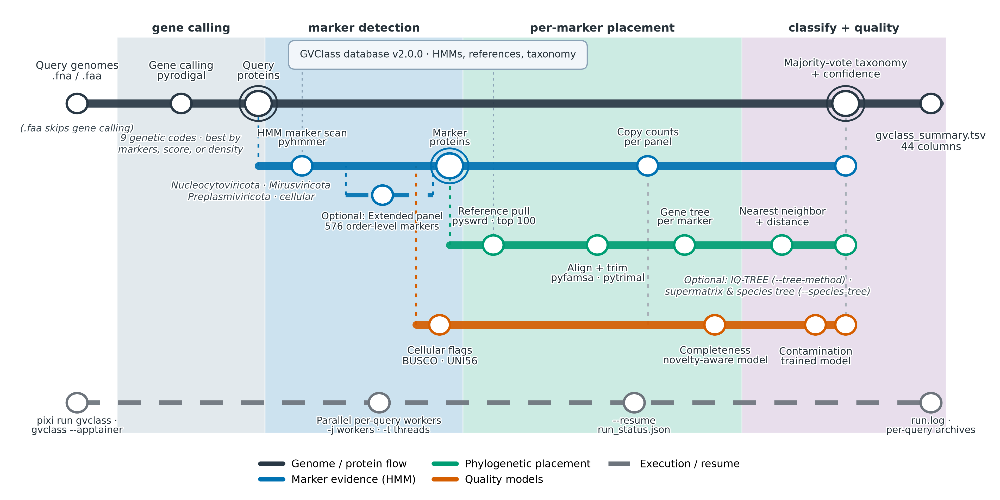

# How GVClass works

GVClass classifies contigs and genome bins from the placement of conserved proteins in reference gene trees. Each marker contributes one vote to the taxonomic assignment. The main results are written to `gvclass_summary.tsv`.

## Gene prediction

For nucleotide input (`.fna`), GVClass uses pyrodigal to test codes 0, 1, 4, 6, 11, 15, 29, 106, and 129. Code 0 denotes metagenomic gene prediction with pretrained models.

Each code is scored by the marker hits of its proteins. A nonzero code replaces code 0 only with marker evidence: at least two more complete hits than code 0, or at least as many complete hits and a 10% higher average best-hit score. Coding density is reported but never decides. Without a complete hit, code 0 stays. Input shorter than 20,000 bp in total uses code 0 only. The selected code is reported in `ttable`; metagenomic mode is reported as `codemeta`. See [genetic codes](../reference/markers.md#genetic-codes) for the exact rule.

Protein input (`.faa`) skips gene prediction and reports `ttable=no_fna`.

## Marker detection and gene trees

PyHMMER searches the predicted or supplied proteins against viral and cellular marker HMMs. Sensitive mode is the default, with sequence and domain E-value thresholds of `1e-5`. Disabling sensitive mode uses the curated gathering thresholds of each model, and `1e-5` for a model without them. Hits and domains that fail the thresholds are discarded.

For each detected marker group, GVClass selects reference proteins with pyswrd, aligns them with the query proteins using pyfamsa, and trims the alignment with pytrimal. VeryFastTree builds the gene tree by default. `--tree-method iqtree` uses IQ-TREE with the `Q.pfam+R10+F` model and a `--fast` search for these marker trees. A marker without a reference set is an error.

Fast mode skips order-level marker trees but still searches their HMMs. `--extended` includes those trees. See [marker panels](../reference/markers.md) and [tree settings](../how-to/tune-speed-and-accuracy.md).

### Reference selection

Each query protein of a marker is searched against the marker's reference proteins (BLOSUM62, E-value at most `1e-5`). The search keeps up to 100 hits per query protein and skips hits below 30% identity. The tree gets at most 100 references.

Every query protein gets its own neighbours. GVClass takes the best hit of each query protein first, then the second best of each, and so on, with the query proteins in ID order. It skips a reference that it already chose. It stops at 100 references or when the hits run out. For one query protein, this is its 100 best hits. Without this rule, one long copy with high scores would take all 100 places, and a short or divergent second copy (for example from a second virus in a mixed bin) would have no close references in its tree.

Within one query protein, hits rank by score, then E-value, then reference ID. The same input therefore gives the same references.

The search of each marker is written to `blastp_out/<marker>.m8`, which the contamination model reads. The file follows the BLAST tabular layout: the alignment length counts gap columns, and the gap-open column counts runs of gaps. The identity column is the value pyswrd reports, matches divided by aligned residue pairs, so gap columns do not lower it. BLAST divides by the alignment length instead. The contamination model was trained on the pyswrd value, so GVClass keeps it.

## Classification and quality estimates

GVClass assigns each query protein the taxonomy of its nearest reference in a marker tree. Marker votes are combined from domain to species, with lower ranks restricted to the selected parent lineage. Assignments without enough distinct markers are withheld. [Taxonomy and classification](taxonomy.md) describes the support thresholds and confidence flags.

Marker recovery, duplication, reference matches, and contig-level evidence contribute to the [completeness and contamination estimates](quality-metrics.md). When the optional contig screen scores a bin, its cellular share replaces the marker-based contamination estimate. Quality scoring uses the accepted consensus lineage. BUSCO and UNI56 are not the only cellular inputs to the contamination model; other marker reference matches can contribute. Gene transfer and endogenous viral elements can complicate the interpretation. Interpret the estimates with the taxonomic assignment, the query-support fields, and model reliability, because the support fields keep missing evidence from looking like a clean genome.

The optional [species-tree analysis](species-tree.md) concatenates a viral marker panel to place each genome among references. `--species-tree-combined` also places eligible queries together in one tree per viral panel.

Start with the [example tutorial](../tutorials/getting-started.md), or follow [Build a species tree](../how-to/build-a-species-tree.md).
